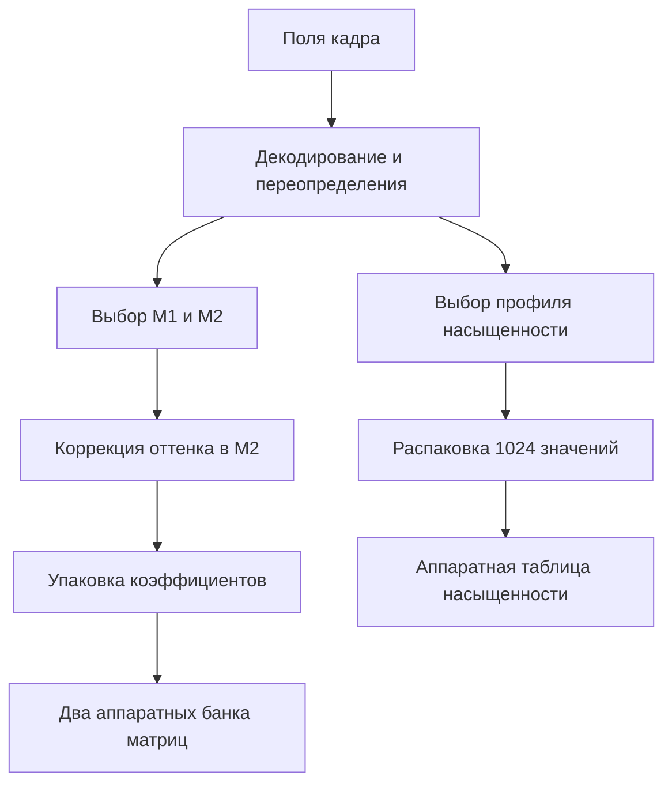

# Цветовая обработка Nikon D40 B 1.11 — разбор v3

Дополнение v4: внешний порядок кадра и уточнённое назначение аппаратных таблиц — в [PIXEL_PIPELINE_RU.md](PIXEL_PIPELINE_RU.md). Значения оттенка −3…+3 ниже обозначают внутренние шаги, соответствующие −9°…+9° в меню; CSV уточнены. Прежние результаты исполнения сохранены.

Разобран путь **настройки цвета: поля кадра → выбор таблиц и матриц → расчёт оттенка → упаковка → аппаратные регистры**. Получены реальные коэффициенты из оригинальной прошивки и воспроизводимые инструменты их извлечения. Это ещё не полная модель превращения RAW в JPEG: порядок обработки пикселей внутри аппаратного блока, нормировка его таблиц, дебайеризация и весь баланс белого не восстановлены.

Источник — неизменённый `BD400111.bin`, SHA-256 `b9df48d461e875dce4ba84da88164af170dfc48ad9f7674859623bad0401032e`. Все адреса ниже — **CPU/ROM**, если не указано RAM или смещение файла. Для рассматриваемого ROM: `file = CPU − 0x40000`.

## Что удалось установить

| Узел | Результат | Проверка |
|---|---|---|
| Режим цвета Ia / II / IIIa | Связь битов настройки с внутренними кодами и семействами матриц | Статика |
| Матрица M1 | 18 таблиц 3×3; знаковые коэффициенты; путь до банка `0x40010022` | Статика и ограниченное исполнение упаковки/копирования |
| Матрица M2 | 21 таблица 3×3; корректировка последних двух строк; банк `0x40010034` | Статика и ограниченное исполнение |
| Оттенок −3…+3 | Таблица коэффициентов 3×4×7; точная структура вычисления и ограничения | Исходные инструкции, но арифметические float-функции заменены хостовыми моделями |
| Насыщенность | Выбор из 48 профилей; распаковка в 1024 байта; запись 1024 полуслов в `0x4001EC00` | Ограниченное исполнение исходного целочисленного кода |
| Чёрно-белая ветвь | Отдельные 35 матриц M1 и 5 профилей с другим форматом сжатия | Статика; распаковка профилей проверена исполнением |
| Четыре таблицы по 16 значений | 18 наборов, связанные с индексом M1, четыре аппаратных банка | Статика; смысл аппаратной операции пока неизвестен |

Здесь M1 и M2 — исследовательские имена. Формат коэффициентов подтверждён, а точные названия аппаратных цветовых пространств — нет.

## Как настройки доходят до обработчика

Штатный код копирует рабочие параметры с RAM `0x83CED224` в структуру кадра начиная с `+0x2C` (вызов `0x45692`, функция `0x4793A`; разбор v2). Глобальный указатель рабочего контекста обработки находится в RAM `0x83EB5864`.

Функция `0x31ED1A` извлекает:

| Поле контекста | Выражение | Рабочая RAM |
|---|---|---|
| Тон | `(ctx[0x2C] >> 2) & 7` | `0x83EB3D50` |
| Насыщенность | `ctx[0x2C] & 3` | `0x83EB3D44` |
| Цвет | `ctx[0x2D] >> 6`, затем перекодирование | `0x83EB3D48` |
| Оттенок | `signed8(ctx[0x2E]) + 3` | `0x83EB3D34` |

| Режим | Код в настройке | Код обработки | Индексы M1 | Индексы M2 |
|---|---:|---:|---|---|
| Ia | 1 | 3 | 0…5 | 0…6 |
| II | 2 | 1 | 6…11 | 7…13 |
| IIIa | 0 | 4 | 12…17 | 14…20 |

Это начальное декодирование. Далее та же функция переопределяет параметры для штатных и сюжетных режимов. Нельзя считать, что произвольная запись Custom всегда дойдёт до матрицы без изменения. В ветви Optimize=6 устанавливается флаг чёрно-белой обработки RAM `0x83EB3D1C` (`0x31F2EA…0x31F33C`).

Схема показывает **поток параметров**, а не доказанный порядок обработки пикселя:



## Матрицы: реальные числа и формат передачи

Выбор и загрузка находятся в функции `0x320CD8`. Обычный путь загрузки начинается с `0x321946`.

| Объект | ROM | Формат | Рабочая RAM | Поле кадра | Аппаратный адрес |
|---|---|---|---|---|---|
| M1 | `0x332888` | 18×9 signed16 | `0x83EB3BE0`, 9 signed32 | `+0x3A4`, 9 uint16 | `0x40010022` |
| M2 | `0x33270E` | 21×9 signed16 | `0x83EB3BBC`, 9 signed32 | `+0x3B6`, 9 uint16 | `0x40010034` |

Первый набор M1:

```text
 721  -124   -85
 -95   686   -79
   2   -87   597
```

У всех 18 матриц M1 сумма каждой строки равна 512. Это согласуется с матрицей цветокоррекции с масштабом 512, сохраняющей нейтральную ось. **Сам масштаб аппаратного умножения и его место в тракте пока выведены только предположительно.**

Первый набор M2:

```text
  76   151    29
 -61   -88   149
 155  -127   -28
```

У всех 21 матрицы первая строка одинакова и имеет сумму 256; суммы двух остальных строк равны нулю. Такая структура согласуется с отделением яркостной составляющей от двух цветоразностных. Этого недостаточно для утверждения о конкретном стандарте YCbCr, диапазоне сигнала или порядке каналов.

При упаковке (`0x323566…0x3235E4`) отрицательные значения передаются **не как дополнительный код**:

- M1: `abs(value) | 0x400`;
- M2: `abs(value) | 0x200`;
- неотрицательные: значение без изменения.

Пример: −61 в M2 становится `0x023D`. Затем цикл `0x4B4CA…0x4B4F2` копирует два массива по 9 полуслов из структуры кадра в аппаратные банки. В проверках использовалась обычная хостовая память вместо оборудования.

Коэффициенты всех 74 извлечённых матриц, включая 35 монохромных, находятся в `data/color_matrices.csv`. В монохромном наборе есть строки с суммой 513; утверждение о строгой сумме 512 относится к обычным 18 матрицам M1.

## Оттенок: изменяется матрица, а не текст пункта

Функция `0x322606` делает резервную копию M2 в RAM `0x83EB3A88`, затем меняет шесть элементов. Первая строка остаётся прежней.

Таблица `0x331AF0` содержит 3 семейства × 4 коэффициента × 7 положений. В этом оригинале **три семейства побайтно одинаковы**. Коэффициенты делятся на 10000; для каждого столбца выполняется:

```text
new_row1 = clamp(trunc(float32(a*old_row1 + b*old_row2)), -511, 511)
new_row2 = clamp(trunc(float32(c*old_row1 + d*old_row2)), -511, 511)
```

Отдельные умножения и сложение также округляются в модели до float32. В центре `a=d=1`, `b=c=0`. Для края −3: `a=d=0.9921`, `b=0.1253`, `c=−0.1254`; для +3: `a=d=0.9961`, `b=−0.0872`, `c=0.0871`. Шаги несимметричны: заменять их произвольным «поворотом на одинаковые градусы» без основания нельзя.

Исходный код ограничивает индекс сверху шестью **беззнаковым сравнением**. Наши модели принимают только штатный диапазон 0…6; они не предлагают вызывать функцию с произвольным отрицательным индексом или неизвестным кодом цвета.

`data/hue_coefficients.csv` содержит исходные целые коэффициенты. `data/hue_example_M2_index0_host_float32.csv` — расчёт для первой M2, с явно указанной хостовой арифметикой. 462 исполнения подтвердили выбор таблиц, адреса записи, сохранение первой строки и ограничения. Это **не побитовая проверка оригинальной библиотеки плавающей арифметики**: её шесть вызовов заменены моделями.

## Насыщенность: выбор профиля и восстановление таблицы

Функция `0x3232D8` читает значение насыщенности `s`, внутреннее семейство `family` и параметры `x=RAM[0x83EB5858]`, `q=RAM[0x83EB5868]`. Физический смысл x и q пока не установлен; называть их ISO, температурой или яркостью преждевременно.

В исследованном диапазоне x≥60:

1. `x = min(x,120)`; `k = ((x−60)×0x1556) >> 16`; следующий столбец — `k+1`, кроме x=120.
2. q выбирает строку 0 при q<143, строку 77 при q>218, иначе `q−142`.
3. Для Auto (`s=0`) используется одна из трёх таблиц 78×6. Для ручных значений 1…3 — таблица 3×6.
4. Из двух полученных номеров выбирается второй при остатке `x−60−12k` равном **6, 8 или 10**. При остальных остатках выбирается первый. Даже нечётные остатки 7, 9, 11 попадают в первый; это проверено исходным кодом, а не заменено предположением о плавной интерполяции.

Ручная таблица `0x33FFAF`:

| Код s | Столбец 0 | 1 | 2 | 3 | 4 | 5 |
|---|---:|---:|---:|---:|---:|---:|
| 1 | 0 | 8 | 16 | 24 | 32 | 40 |
| 2 | 7 | 15 | 23 | 31 | 39 | 47 |
| 3 | 6 | 14 | 22 | 30 | 38 | 46 |

Номер сохраняется в RAM `0x83EB786C`, затем в `ctx+0x46C`. Функция `0x324124` восстанавливает выбранный профиль:

- 48 потоков по 511 байт начинаются с ROM `0x34052B`;
- первые два значения берутся из таблиц `0x3404FB` и `0x3404CB`;
- в каждом байте сначала старшая, затем младшая тетрада;
- очередное значение: `y[n] = (2*y[n−1] − y[n−2] + nibble − 8) & 255`;
- результат — ровно `2 + 511×2 = 1024` байта в RAM `0x83EB78F4`.

Это кодирование вторых разностей. Прошивка записывает результат в байт, поэтому переполнение оборачивается по модулю 256; это не ограничение к диапазону 0…255 через clamp.

Копирование `0x4B678…0x4B698` вызывает цикл `0x4BEE6`: каждый байт расширяется без знака и записывается как полуслово в `0x4001EC00`. В аппаратный блок поступает 1024 значения. **Индекс этой таблицы пока нельзя отождествить с входной яркостью, а значение — с готовым выходным цветом.** Для этого нужна семантика аппаратного блока.

Все профили экспортированы в `data/saturation_luts.csv`; выбор — в `data/saturation_selection_tables.csv`; хеши — в `data/saturation_lut_stats.json`. Исходный код распаковки всех 48 профилей дал точное совпадение с независимой целочисленной моделью.

## Монохромная ветвь и дополнительные таблицы

При флаге `0x83EB3D1C` используются 35 матриц M1 из `0x331B98` и M2 из байтов `0x3471F3`: первая строка `[77,150,29]`, остальные нули. Индексы матриц зависят от внутренней группы 0…4 и тонового варианта 0…6. Полная доступность всех этих комбинаций через меню ещё не доказана.

Профили 1000…1004 содержат по 256 байт с четырьмя 2-битными полями. Формула аналогична цветной, но приращение равно `field−2`. Декодер действительно выдаёт **1026 байт**, а аппаратный копировщик забирает первые **1024**. Все пять потоков в этом оригинале дают одинаковый результат. Это установленные размеры; само по себе наличие двух неиспользуемых значений не доказывает ошибку прошивки.

Ещё одна таблица — `0x331E0E`, 18 наборов по 64 uint16. Набор выбирается тем же индексом, что M1; четыре группы по 16 значений проходят через RAM `0x83EB3B7C`, `0x83EB3B3C`, `0x83EB3AFC`, `0x83EB3ABC` и поля кадра `+0x3DC/+0x3FC/+0x41C/+0x43C`. Аппаратные адреса: `0x4001E400/420/440/460`. В исходных таблицах диапазон 0…256. Их влияние на пиксели пока неизвестно; присваивать им название «3D LUT» нет оснований.

## Что это даёт для Cinema 2383

Теперь известны конкретные точки для будущего экспериментального стиля: матрицы M1/M2, корректировка оттенка, выбор/данные профиля насыщенности и тоновая кривая из v2. Это позволяет строить воспроизводимые модели и готовить точечные изменения с проверкой исходных байтов.

Для точного переноса Cinema 2383 пока не хватает следующего:

1. Содержимое целевого преобразования, его входное и выходное цветовые пространства. Содержимое ранее названного `Cinema_2383.json` получить не удалось; никаких его коэффициентов в этом пакете нет.
2. Порядок стадий обработки пикселей, их масштабирование, гамма, округление и клиппинг; смысл аппаратной таблицы насыщенности.
3. Все зависимости выбора матриц от баланса белого и режимов камеры; подтверждение полного применения настроек к JPEG и встроенному превью.
4. Аппаратные сравнения исходного и изменённого результата при одинаковых экспозиции, освещении и балансе белого.

Наличие матриц и одномерных таблиц не доказывает возможность точно реализовать произвольную трёхмерную цветовую трансформацию. Обоснованный первый эксперимент — **приближение заданного стиля средствами найденных блоков**, после установления их поведения. Повышение разрешения, восстановление пересвеченных деталей или уменьшение шума этим разбором не подтверждены.

## Воспроизведение и границы проверки

```bash
python tools/extract_v3.py /path/to/BD400111.bin /path/to/output
python tools/check_color.py /path/to/BD400111.bin
```

В этой версии прошли:

- 53 полных исполнения распаковщика: 48 цветных и 5 монохромных профилей;
- 1092 исполнения выбора двух кандидатов насыщенности;
- 192 полных исполнения выбора насыщенности, включая необычные нечётные остатки;
- 399 пар проверок: упаковка двух матриц и копирование в имитацию аппаратных регистров;
- 462 исполнения регулировки оттенка с явно заменённой float32-арифметикой.

Все обращения происходили в синтетической памяти на компьютере. Интерпретатор ограничен наблюдаемыми инструкциями; неизвестная инструкция или немаппированная память останавливает проверку. Он не эмулирует камеру, её ОС, сенсор, JPEG-блок или flash. Прежние проверки v2 сохранены отдельно в истории валидации.

Исходные BIN не изменены. В архиве нет прошивки для установки. Листинги с исходными байтами и хешами находятся в `evidence/B_color_*`, таблицы и карта пути — в `data/`, проверочные инструменты — в `tools/`.
