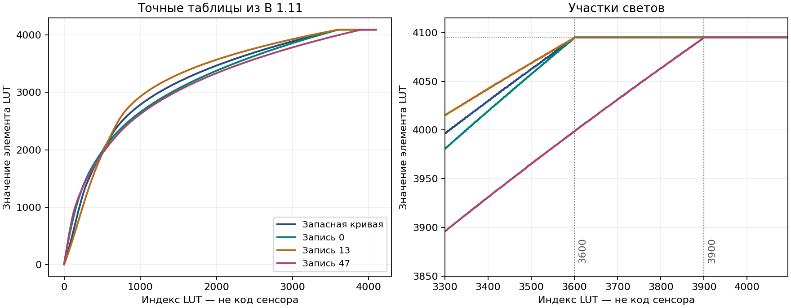

# Nikon D40: диапазоны, округление и ограничение светов, v6

28 октября 2026 года. Прошивка B 1.11, SHA-256:
`b9df48d461e875dce4ba84da88164af170dfc48ad9f7674859623bad0401032e`.
ROM CPU = смещение файла + `0x40000`. MMIO — отдельное адресное пространство.

**Точно установлены численные правила построения таблиц и упаковки коэффициентов. Точное вычисление пикселя внутри ASIC, включая места обрезания после матриц, пока не восстановлено.** В v6 выполнено 50 прогонов оригинального построителя кривой без подмены функций и сравнено 204 800 выходных элементов; отдельно проверены все 8448 элементов статических LUT и оригинальное преобразование float→int.

## 1. Порядок стадий: текущий статус

Рабочая гипотеза остаётся прежней: **корень → демозаика → квадрат → M1 → тоновая кривая → M2**. Это сопоставление бинарных объектов D40 с первичными описаниями Nikon, а не установленная маршрутизация конкретного ASIC. Источники и соответствия приведены в [STAGE_ORDER_RU.md](STAGE_ORDER_RU.md): US7957588B2, первый вариант, и EP2046067A1, Fig. 2, раздел Standard Digital Camera. Упомянутая там Matrix 3 соответствует нашей предполагаемой M1.

Ни один новый численный тест не доказывает этот порядок. Положение насыщенности, резкости, таблицы 8→12 бит и промежуточных ограничителей остаётся неизвестным. Повторная проверка загрузчика подтвердила прежние 14 439 записей; она не вычисляет изображение.

## 2. Точные диапазоны статических LUT

Все значения ниже относятся к **индексам и содержимому таблиц**, не к измеренным сигналам сенсора. Элементы хранятся в u16, но полезный диапазон исследованных значений не превышает 12 бит. Из этого не следует 12-битная ширина всех внутренних сумматоров.

| MMIO | Индексы | Точная формула содержимого | Минимум…максимум |
|---|---|---|---|
| `0x40010200` | 0…255 | `floor(i*4095/255 + 0.5)` | 0…4095 |
| `0x40010400` | 0…4095 | `min(4095, floor(sqrt(4096*i)+0.5))` | 0…4095 |
| `0x40012400/14400/16400` | 0…4095 | `floor(i*i/4096 + 0.5)` | **0…4094** |

Формулы повторно сверены целочисленной арифметикой, включая `isqrt`, без погрешности вычисления квадратного корня в float. Таблицы предвычислены: это совпадение их байтов с формулами, а не обнаруженная инструкция аппаратного округления. На данном дискретном наборе нет точных полуцелых результатов квадратной формулы; поэтому различить правила обработки ровно 0.5 по этим байтам нельзя.

Граничные особенности:

* Корень отображает индексы 4094 и 4095 в одно значение 4095.
* Квадрат отображает индексы 0…45 в ноль; при 4095 выдаёт 4094.
* При **математическом** непосредственном соединении `square[sqrt[i]]` ошибка равна −1, 0 или +1; 3072 из 4096 входов восстанавливаются точно. Для обратной композиции ошибка −45…+18.

Последний пункт — анализ квантования таблиц. В предполагаемом реальном тракте между ними находится пространственная обработка, поэтому взаимное сокращение этих операций не моделирует камеру и не обосновывает их удаление.

## 3. Пользовательская кривая: порядок вычислений доказан кодом

Оригинальный построитель `0x323C22` получает 2048 **беззнаковых 16-битных** отсчётов `C[j]`. Для основной и альтернативной ветвей выполнены оригинальные инструкции, включая проверку выбора источника, интерполяцию и обе границы ограничения. Возвращается массив из 4096 u16 по `0x83EB586C`.

Сначала строится `B`:

* `B[2*j] = C[j]`;
* `B[2*j+1] = floor((C[j]+C[j+1])/2)` при `j=0…2046`;
* `B[4094] = B[4095] = C[2047]`.

Затем `T[i] = min(4095, max(0, B[i] + D[9*i+k]))`, где `D` — знаковый байт коррекции, `k=ctx[0x6AE]`, шаг 9 задан штатной инициализацией. В оригинальном образе **все 36 864 байта D равны нулю**. Наличие поля k само по себе не означает девять различных цветовых стилей.

**Округление середины — вниз, без прибавления 0.5.** Например, соседние значения 0 и 4095 дают 2047. Сложение выполняется до сдвига в 32-битных регистрах, поэтому сумма двух u16 не переполняется в u16. Коррекция и ограничение применяются после интерполяции, независимо для каждой выходной точки.

Контрпример, проверенный оригинальным кодом: при исходной паре 0 и 8191 середина становится 4095. Если сначала ограничить исходные узлы значением 4095, получилась бы другая середина — 2047. Такой нештатный вход использован только как численный тест; он не загружался в камеру.

Для проверки отрицательной границы отдельно подставлялись синтетические байты коррекции −128…127 вместо нулевых данных. Исполняемый код оставался оригинальным. Это проверка ветвей функции, а не утверждение, что штатная камера использует ненулевую коррекцию.

Важное различие: простые функции `0x4BF06/0x4BF58` тоже интерполируют 2048→4096, но **не содержат ограничения 0…4095**. Нельзя переносить правило ограничения из полного построителя на любой похожий цикл.

## 4. Найденное ограничение светов в штатных данных

| Набор | Начало постоянного участка `T[i]=4095` | Число одинаковых конечных элементов |
|---|---:|---:|
| Запасная кривая ROM `0xDC294`, после интерполяции | **3600** | 496 |
| 21 запись с индексами построителя 0…20 | **3600** | 496 |
| 7 записей с индексами 47…53 | **3900** | 196 |

Все 28 распакованных штатных записей монотонны, не превышают 4095 ещё до ограничителя и проверены исполнением. Границы 21 и 7 записей определены по расположению таблиц начальных значений. Достижимость каждого индекса в штатном меню не доказана; индексы нельзя выдавать за названия пользовательских режимов.

Запасная кривая начинается с 9, 12, 16, 19, 23, 27, 31, 35 и заканчивается указанным плато. Это заложенная в таблицу форма, а не результат переполнения при распаковке.



При прямой индексации такие участки теряют различимость входных уровней. Но **3600 — индекс LUT, не установленный уровень насыщения сенсора и не поправка экспозиции**. Чтобы вывести фактический запас светов в ступенях, нужно знать нормировку входа таблицы, баланс белого, предыдущую матрицу и места насыщения. Растяжение плато в новой кривой не восстановит информацию, уже обрезанную раньше.

## 5. Матрицы: коэффициенты и пиксельные значения — разные диапазоны

| Свойство | M1 | M2 |
|---|---|---|
| Исходные записи ROM | 18 × 9 s16 | 21 × 9 s16 |
| Найденный диапазон коэффициентов | −485…969 | −132…187 |
| Суммы строк | 512, 512, 512 | 256, 0, 0 |
| Предполагаемый делитель | 512 (Q9) | 256 (Q8) |
| Упаковка отрицательного коэффициента | `abs(v) OR 0x400`, затем u16 | `abs(v) OR 0x200`, затем u16 |

Делители согласуются с данными, но сами операции деления/сдвига ASIC не найдены. Последовательность каналов и добавление смещения цветоразностей также не подтверждены.

**Упаковщик CPU не защищает коэффициенты ограничением до предполагаемой ширины поля.** Проверенные нештатные значения +1024 для M1 и +512 для M2 попадают в слова `0x400` и `0x200`, пересекающиеся с предполагаемыми знаковыми битами. Значение +65536 при записи u16 превращается в 0. Поэтому будущий генератор патча должен проверять допустимость коэффициентов заранее; успешная сериализация не доказывает их допустимость для чипа.

В обработчике оттенка M2 есть отдельное программное ограничение изменяемых коэффициентов до −511…511. Оно не является ограничением яркости пикселя. Общий упаковщик M1/M2 такого ограничения не добавляет.

Если **предположить** независимые входы R,G,B в 0…4095 и делитель 512, крайние результаты M1 по всему исследованному набору лежат в −3879.053…7974.053 до ограничения. Это математические границы линейных форм на кубе входов, не измерения D40. Они показывают, почему нельзя просто предположить отсутствие отрицательных значений и промежуточного запаса разрядности.

## 6. Округление коэффициентов float→int

Разобран и выполнен оригинальный помощник `0xBE8DE`, вызываемый при вычислении оттенка. **Для конечных значений он отбрасывает дробную часть к нулю:** +1.9→1, −1.9→−1. Это отличается от округления вниз отрицательных значений. При конечном выходе за signed32 помощник ограничивает результат границами int32; последующий код оттенка ограничивает коэффициенты уже до ±511.

Проверено 2066 конечных входов, включая дробные значения вокруг границ и переполнение signed32; NaN и бесконечности не исследовались. Умножение/сложение float во всём алгоритме оттенка здесь не проверено побитно. **Это правило CPU для коэффициентов, не правило округления произведений матрицы и пикселя в ASIC.**

## 7. Незакрытые вопросы и следующий различающий тест

Не установлены: истинная последовательность и обход стадий для каждого режима; ширина внутренних аккумуляторов; округление после матриц; обработка отрицательных результатов; ограничение до или после тоновой кривой; правило преобразования 12→8 бит; диапазон и смещения YCbCr. Одна только выгрузка настроек не ответит на эти вопросы.

При доступе к управляемому входу нужны цветные, а не только серые пробы. Для M1 и кривой следует различить `T(M1*x)` и `M1*T(x)`, исключив клиппинг. Для округления — подобрать входы около половины младшего разряда предполагаемого деления. Для ограничителей — значения непосредственно ниже и выше границ с наблюдением выхода до JPEG. Сжатый JPEG вносит собственные изменения и не даёт надёжно определить однобитное округление. Для корня/демозаики нужны пространственные Bayer-пробы. Такого аппаратного доступа и измерений в текущем исследовании нет.

## Воспроизведение и источники инструкций

```bash
python3 tools/check_numeric_pipeline.py /path/to/BD400111.bin /tmp/validation_v6.json
```

Результат: `VALIDATION_v6.json`; данные для графика: `data/numeric_tone_curves.csv`. Тесты не изменяют исходный BIN, не подключаются к камере и не эмулируют ASIC. Для ошибочных входов используется только синтетическая память. Путь прямой байтовой кривой с `ctx[0x1D]&0x20` не включён в 50 прогонов.

Ограниченный FR-интерпретатор расширен инструкциями BTSTH, BN/BP и LSR с регистровым счётчиком. Правила взяты из первичного руководства **Fujitsu CM71-00101-5E**, доступного в зеркалах: [§7.33 BTSTH](https://fujitsu.manymanuals-pt.com/unknown/CM71-00101-5E/user-manual-11212/143), [§7.47 LSR](https://www.manualsdir.com/manuals/103548/fujitsu-fr-family-32-bit-microcontroller-instruction-manuel-cm71-00101-5e.html?page=165), [§7.99 Bcc:D](https://manualsdump.com/en/manuals/fujitsu-cm71-00101-5e/119873/227). Добавлены 21 точечная проверка новых операций; BN/BP дополнительно проходят положительные, нулевые и отрицательные случаи построителя и преобразования float→int. Сохраняются ограничения интерпретатора, описанные в его исходнике.

Повторно пройдены проверки цвета и загрузки v3/v5 с расширенным интерпретатором. Проверки остальных модулей сохранены как исторические результаты и полностью не перезапускались.
