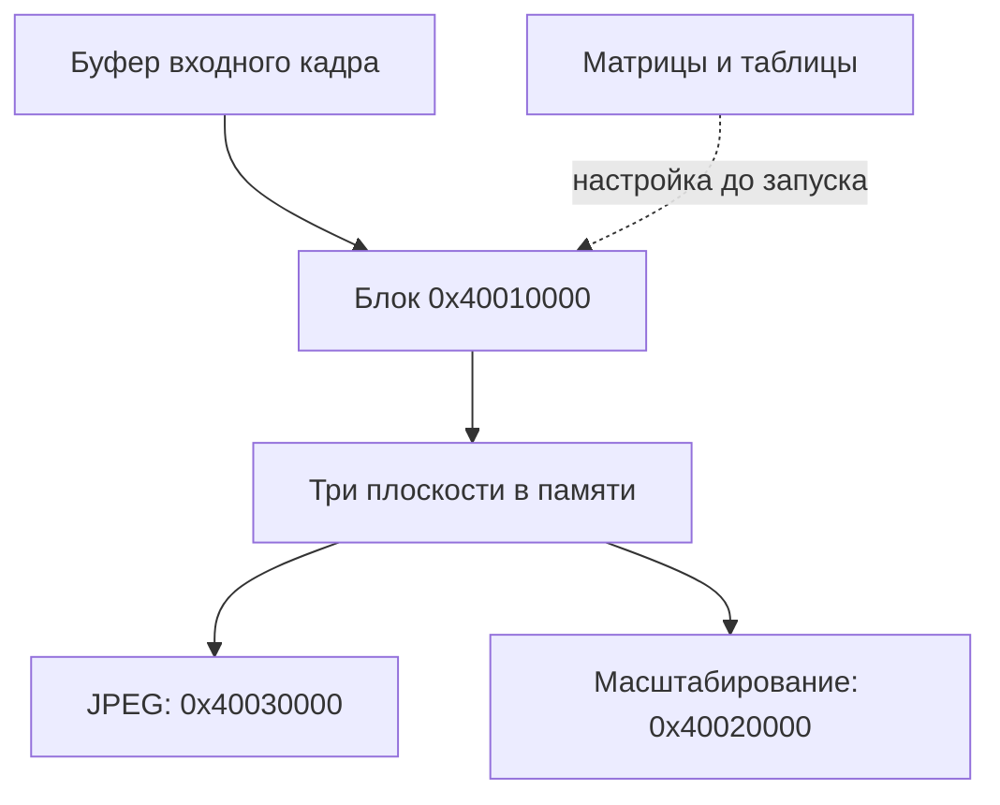

# Nikon D40: порядок обработки и аппаратные таблицы, v4

**Дополнение v5:** рабочая реконструкция внутреннего порядка и её ограничения приведены в [STAGE_ORDER_RU.md](STAGE_ORDER_RU.md). Ниже сохранены результаты v4; непосредственного подтверждения порядка ASIC по-прежнему нет.

28 октября 2026 года. Исследован **BD400111.bin, B 1.11**, SHA-256
`b9df48d461e875dce4ba84da88164af170dfc48ad9f7674859623bad0401032e`.
Для ROM: адрес CPU = смещение файла + `0x40000`. Адреса `0x400xxxxx` ниже — аппаратное адресное пространство, не смещения BIN.

**Установлен внешний порядок обработки кадра и математическое содержимое нескольких аппаратных таблиц. Полный порядок операций над пикселем внутри чипа пока не установлен.** Запись таблиц процессором не показывает, в какой последовательности аппаратные узлы их применяют. Никаких снимков модифицированной камерой или испытаний на устройстве в этом исследовании нет.

## 1. Что теперь известно о потоке изображения

В прослеженных ветвях функция `0x4B168` вызывает расчёт параметров `0x31A0F8`. Затем `0x4B260` задаёт входной буфер, три выходных адреса, геометрию, вызывает загрузчик параметров `0x4B41C`, запускает блок `0x40010000` и ожидает завершения. Только после возврата вызывается последующая обработка.



Это карта прослеженных связей буферов. Она не утверждает, что каждый снимок проходит обе выходные ветви, что JPEG всегда строится после масштабирования, или что восстановлена ветвь записи NEF. Считывание матрицы, чёрный уровень, дефектные пиксели, баланс белого и демозаика здесь не расставлены по порядку: соответствующие границы аппаратных стадий не доказаны.

### Вход, выход и завершение прохода

Обозначения: `ctx` — контекст кадра, `desc` — дескриптор буфера, `base = *(desc+0x0C)`.

| Регистр | Значение, записываемое оригинальным кодом | Установленный смысл |
|---|---|---|
| `0x4001FF08` | `*(ctx+0x14) + geometry[0]` | Адрес входа, подтверждаемый связью с последующим выходом; формат входных выборок ещё не проверен |
| `0x4001FF04` | `u16(geometry+4)` | Параметр геометрии; вероятный шаг входной строки в байтах |
| `0x4001FF06` | `u16(geometry+6)` | Параметр геометрии; в полной записи 3040 |
| `0x40010002`, `0x40010004` | `u16(geometry+8)`, `u16(geometry+10)` | Геометрия обработки |
| `0x4001FF0C` | `base + 0x2F90` | Первая выходная плоскость |
| `0x4001FF10` | `base + 0x5CF590` | Вторая выходная плоскость |
| `0x4001FF14` | `base + 0x8B5890` | Третья выходная плоскость |

Управляющая последовательность `0x4B39C–0x4B3FA`: очищается бит события ОС `0x00400000` в группе 4; записываются `0x100` в `0x4001FF18` и `0x4000` в `0x4001FF00`; управляющее слово `0x40010000` становится `(geometry.control & ~0x300) | 0x100`; затем следует ожидание этого события. После ожидания код записывает `0x0800` в `0x40010000` и ноль в `0x4001FF00`.

Обработчик `0x47874` проверяет бит 0 регистра `0x4001FF18`, выполняет операцию подтверждения и сигнализирует тот же бит события ОС. Это устанавливает границу завершения аппаратного прохода. Названия отдельных управляющих битов и электрическое поведение регистров не взяты из документации чипа и не считаются установленными.

### Формат выходных плоскостей

Расстояния между их началами:

* `0x5CF590 − 0x2F90 = 6 080 000 = 3040 × 2000` байт;
* `0x8B5890 − 0x5CF590 = 3 040 000 = 1520 × 2000` байт.

JPEG-драйвер `0x49A7C` получает эти адреса через `0x4883A`. Он записывает шаг первой плоскости в `0x40030F02`, а половинный шаг в `0x40030F08`; адреса трёх плоскостей попадают в `0x40030F10/14/18`. Код заполнения полей изображения использует 0 для первой плоскости и 128 для двух других. Совокупность признаков **сильно поддерживает планарный YCbCr 4:2:2 с 8-битными отсчётами**. Порядок Cb/Cr, диапазон полного/ограниченного уровня и расположение цветовых выборок относительно яркостных ещё не установлены.

JPEG-блок определён не только по похожим адресам: загрузчик `0x49F74` использует таблицы ROM `0xC642E` и `0xC6360`. Все **412 байт** двух наборов DC/AC совпали с первичным исходником libjpeg-turbo `src/jstdhuff.c`. Отдельно проверены регистры передачи геометрии и трёх плоскостей. Это не означает, что весь JPEG-кодек выполнен в эмуляторе.

Ветви `0x4AE0E` и `0x4AE5E` после `0x4B260` вызывают `0x4867E` или `0x48704`. Те передают три плоскости функции `0x494F2`, задающей отношения размеров и адреса блоку `0x40020000`. Это обоснование назначения масштабирования.

### Формат входа: пока гипотеза

Запись ROM `0xC65DC` содержит `source_offset=0x23AC`, поля 4560, 3040, 94, 2000, control=`0x0805`. Равенства `4560 = 3040 × 12/8`, `0x23AC = 2 × 4560 + 12` согласуются с упакованным 12-битным входом и отступом. Значение `94 × 32 = 3008` согласуется с шириной полного JPEG. Это **вывод из геометрии**, а не разбор фактических пиксельных данных. Байтовый порядок упаковки и порядок Bayer-каналов не установлены. Остальные девять записей сохранены без навязанных названий полей в `data/hardware_geometry_records.csv`.

## 2. Математический смысл таблиц

`i` ниже — индекс элемента таблицы; это ещё не доказательство того, какой именно промежуточный сигнал чип использует как индекс.

| Аппаратный банк | Размер | Содержимое и степень уверенности |
|---|---:|---|
| `0x40010200` | 256 × u16 | **Точно:** `floor(i × 4095 / 255 + 0.5)`, масштабирование кодов 8 → 12 бит |
| `0x40010400` | 4096 × u16 | **Точно:** `min(4095, floor(sqrt(4096 × i) + 0.5))` |
| `0x40012400`, `0x40014400`, `0x40016400` | каждый 4096 × u16 | **Точно:** `floor(i² / 4096 + 0.5)`; одна таблица загружается в три банка |
| `0x40018400`, `0x4001A400`, `0x4001C400` | каждый 4096 × u16 | Одна рассчитанная тоновая кривая копируется в три банка; происхождение Custom разобрано в v2 |
| `0x40010022` | 9 × u16 | M1: знако-модульная упаковка матрицы; 18 штатных цветных вариантов, строки исходных коэффициентов суммируются в 512 |
| `0x40010034` | 9 × u16 | M2: первая строка `[76,151,29]`, две другие с нулевой суммой; оттенок изменяет две последние строки |
| `0x4001E400/20/40/60` | 4 × 16 u16 | Во всех 18 наборах четыре строки: 256, 0, 0, 256, каждая константа повторена 16 раз |
| `0x4001EC00` | 1024 × u16 | Установлена связь с насыщенностью: 48 цветных профилей, выбор, распаковка и загрузка; исходные значения u8 |
| `0x4001E600` | 256 × u16 | Профиль выбирается через `ctx+0x467`; форма нелинейная, роль входного индекса не установлена |
| `0x4001E800`, `0x4001EA00`, `0x4001FC00` | каждый 256 × u16 | Индексы связаны с расчётом резкости; физический смысл отсчётов ещё не установлен |

Для трёх статических формул проверены **все 8448 исходных элементов**, без подгонки по нескольким точкам. Оригинальная функция `0x4BE82` выполнена с синтетической памятью: **16 640 записей u16** совпали с ожидаемыми таблицами. Это разные количества: таблица квадрата физически копируется трижды.

Квадратный корень и квадрат приблизительно взаимно обратны после нормировки к 4096, с ограничениями округления и диапазона. Это не доказывает, что они стоят рядом, применяются к одному сигналу или взаимно уничтожаются. Не следует подписывать их «sRGB gamma» или «Cinema LUT»: таких назначений код не подтверждает.

M1 по структуре похожа на цветокоррекцию с масштабом 512. M2 похожа на преобразование RGB в яркостный и два цветоразностных канала с масштабом 256. Поддержка второй интерпретации сильная: первая строка яркостного вида, две нулевые суммы, корректировка оттенка только этих двух строк и последующий трёхплоскостный JPEG-тракт. Но порядок входных каналов, аппаратные делители, добавление смещения 128, насыщение и округление остаются непроверенными деталями.

Четыре набора по 16 элементов можно интерпретировать как 16 единичных матриц 2×2 при масштабе 256. **Это гипотеза**, а не доказанное назначение: все штатные наборы одинаковы, поэтому их сравнение не раскрывает, чем индексируются 16 позиций. Называть их «16 секторами оттенка» пока нельзя.

## 3. Четыре короткие LUT: что удалось отделить от цвета

| Банк | Распаковщик CPU | Начало упакованных данных ROM | Поле контекста | Формат |
|---|---|---|---|---|
| E600 | `0x324020` | `0x3472FC` | `+0x467` | 127 байт, поля 4 бита → 256 значений |
| E800 | `0x3240A2` | `0x346A37` | `+0x469` | 127 байт, поля 4 бита → 256 значений |
| EA00 | `0x324062` | `0x34650F` | `+0x468` | 64 байта, поля 2 бита → 258 значений; копируются 256 |
| FC00 | `0x3240E4` | `0x3467A3` | `+0x46A` | 64 байта, поля 2 бита → 258 значений; копируются 256 |

Во всех четырёх случаях:

`y[n] = (2*y[n−1] − y[n−2] + delta) & 255`, где `delta = nibble−8` либо `two_bits−2`.

По размещению массивов начальных значений выделено по 10 профилей. **Все 40 распакованы оригинальными инструкциями** и сравнены с независимой моделью рекуррентного восстановления; затем проверены 40 вызовов оригинального загрузчика u8→u16. Это не доказывает достижимость каждого индекса из пользовательского меню.

В `0x31EF16` настройка резкости извлекается из старших трёх бит `ctx[0x2C]` в RAM `0x83EB3D20`. Функция `0x3229CA` использует её при расчёте индекса записи, а в `0x322D00–0x322D1C` сохраняет один выбранный индекс сразу в `0x83EB3A80`, `0x83EB3A7C`, `0x83EB3A78`. Они сериализуются в `ctx+0x469/+0x46A/+0x468`, то есть E800/FC00/EA00. Это доказывает связь с настройкой резкости, но не говорит, применяются таблицы к яркости, величине градиента, порогу шума или иному сигналу.

E800 и FC00 имеют выраженный максимум внутри диапазона и значения около нуля на краях. EA00 также немонотонна. Простая подпись «гамма-кривые RGB» не соответствует имеющимся свидетельствам. Для E600 профиль приходит из RAM `0x83EB3C08`, заполняемой в `0x320CCC`; точное назначение не установлено.

## 4. Дополнение к входам селектора насыщенности

В v3 величины `x` и `q` были известны только по адресам RAM. Теперь найден их источник в `0x31B6D2`:

* `x = u8(ctx+0x6D)` → RAM `0x83EB5858`.
* `q` вычисляется из 15 знаковых 16-битных полей `ctx+0x104 … ctx+0x120`: сумма, знаковое деление на 15 через `0xBE78C`, умножение на 3, арифметический сдвиг на 5, прибавление 128 и ограничение 0…255 → RAM `0x83EB5868`.

То есть статически восстановлена формула `q = clamp(128 + ((3 * trunc(sum/15)) >> 5), 0, 255)`. Инструкции деления отдельно сохранены; в ограниченном интерпретаторе эта функция не запускалась. Первичные физические единицы 15 полей и `ctx+0x6D` ещё не установлены: имена ISO/экспозиция/цветовая температура здесь не присвоены.

## 5. Какой порядок пока нельзя выдавать за установленный

Для гипотезы «демозаика → баланс белого → M1 → тоновая кривая → M2 → насыщенность → резкость» недостаточно доказательств. Не установлены:

1. Место квадратного корня и квадрата относительно демозаики и матриц.
2. Положение тоновой кривой относительно M1/M2 и балансировки каналов.
3. Входная ось 1024-элементной LUT насыщенности и правило применения её результата.
4. Смысл 16 позиций вспомогательных таблиц и входных осей коротких LUT.
5. Разрядность, клиппинг, округление и соседство выборок внутри аппаратного блока.

Объяснение ограничения конкретное: процессор загружает коэффициенты и запускает целый проход. В разобранном фрагменте нет CPU-цикла, вычисляющего новый RGB каждого пикселя. Порядок адресов или записей регистров не задаёт топологию аппаратного конвейера. Одинаковая программа настройки совместима с разными внутренними схемами чипа.

Для будущей идентификации нужны наблюдения, различающие модели. Например, изменение одной кривой и одной смешивающей матрицы на одном фиксированном входном кадре позволяет различить `T(Mx)` и `M(Tx)`: они обычно дают разные результаты. Для коротких LUT полезны отдельно равномерные поля и границы одинаковой средней яркости; для 16-позиционных таблиц — набор цветовых направлений с постоянной яркостью. Сначала следует использовать штатные настройки и фиксированные NEF/JPEG-пары. Изменение аппаратных коэффициентов требует отдельного проверенного исследовательского способа запуска и восстановления; такого способа в пакете нет.

## 6. Следствие для Cinema 2383

Подтверждённые точки управления — тоновая кривая, матрицы, оттенок, выбор профиля насыщенности. Но **нет основания обещать точное воспроизведение заданного 3D-преобразования**: аппаратная 3D LUT не обнаружена, а семантика части найденных таблиц не восстановлена. Отсутствие находки не доказывает отсутствие такой возможности в чипе.

Следующий полезный результат — идентифицированная модель с измеренным отклонением на снимках D40, затем приближение целевого стиля средствами этой модели. Произвольная запись Cinema 2383 в банк квадратного корня, насыщенности или резкости без знания его входной оси не является корректной реализацией режима. Новый устанавливаемый BIN в v4 не создавался.

## 7. Воспроизводимость и уточнения v3

```bash
python tools/extract_v4.py /path/to/BD400111.bin /path/to/output /path/to/jstdhuff.c
```

Последний аргумент — необязательный первичный исходник libjpeg-turbo. Если его не передать, сравнение с внешними таблицами явно отмечается `NOT RUN`. Хеш использованной копии записан в `data/jpeg_huffman_identification.json`; сам сторонний исходник не включён в архив.

Результат: `VALIDATION_v4.json`; извлечённые значения: `hardware_static_luts.csv`, `hardware_small_luts.csv`; листинги и хеши диапазонов: `evidence/B_pixel_*` и `data/v4_evidence_ranges.json`. Дополнительно есть `data/pixel_pipeline.json` с уровнями уверенности. Старые проверки v1–v3 сохранены как история; повторный прогон всех старых тестов не заявляется.

Уточнение единиц оттенка: значения −3…+3 в прежних CSV — **внутренние шаги**, а не градусы меню. По руководству D40, печатная стр. 69, это −9°…+9° с шагом 3°. В v4 столбцы названы `internal_hue_step` и `menu_hue_degrees`. Коэффициенты и прежние результаты исполнения от этого не меняются.

Первичные внешние источники:

* [Nikon D40, руководство](https://download.nikonimglib.com/archive2/4lyqy00hteoi016sWRu47JfeZR67/D40_EU(En)06.pdf), стр. 69 — пользовательские настройки и единицы оттенка.
* [libjpeg-turbo, jstdhuff.c](https://github.com/libjpeg-turbo/libjpeg-turbo/blob/main/src/jstdhuff.c) — эталон для побайтного распознавания таблиц JPEG.

Адреса, потоки данных, формулы LUT и результаты ограниченного исполнения получены нашим анализом точного BIN. Они не являются официальной картой регистров Nikon или Fujitsu.
